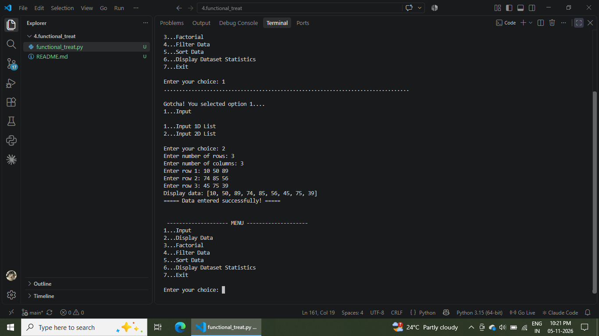
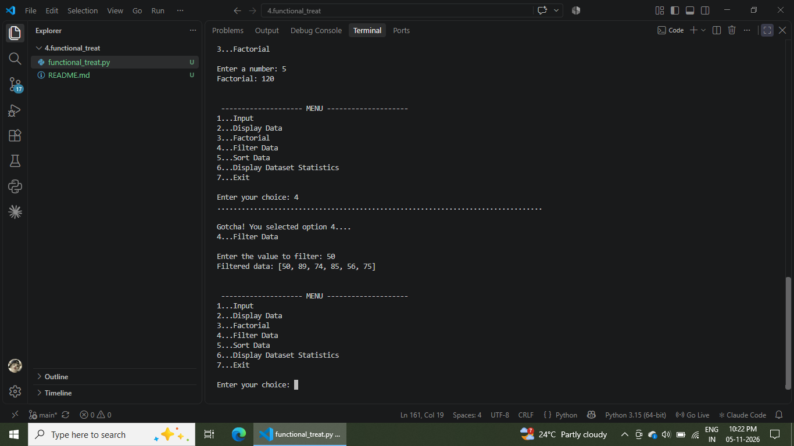
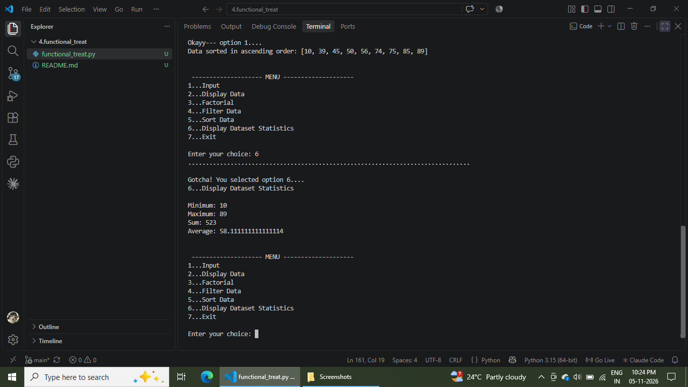
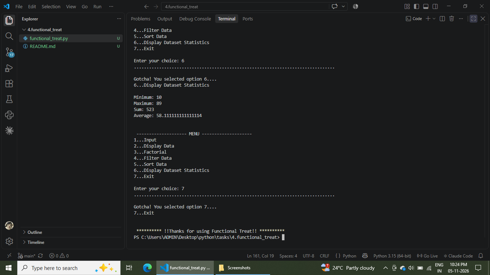

# ..........FUNCTIONAL TREAT..........

## Covered Topics
-conditions
-built-in functions
-UDF functions
-1D Array
-2D array
-lambda function
-filter()
-map()
-match case
-jumping statements

## 1 = Input

## 2 = Display

## 3 = Factorial

## 4 = Filter

## 5 = Sorting

## 6 = Display Dataset

## 7 = Exit

